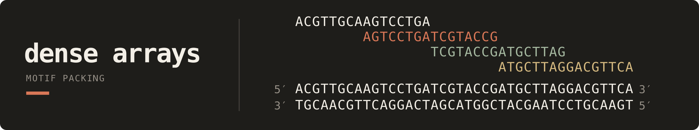

# 

[](https://github.com/e-south/dense-arrays/blob/main/pyproject.toml)
[](https://pypi.org/project/dense-arrays/)
[](https://github.com/e-south/dense-arrays/actions/workflows/ci.yml)
[](https://dunloplab.gitlab.io/dense-arrays)
[](https://github.com/e-south/dense-arrays/blob/main/LICENSE)

Dense Arrays designs nucleotide sequences with densely packed DNA-protein binding
sites. It uses optimal string packing to arrange overlapping sites on both DNA
strands, with controls for sequence length, site placement, and library diversity.

## First array

Use Python 3.12 or later. This example packs four synthetic 16-base motifs into a
40-base array.

```bash
python -m venv .venv                       # Create an isolated Python environment.
source .venv/bin/activate                  # Activate it on macOS or Linux.
python -m pip install dense-arrays         # Install the released package and CBC solver.

# Fit four sites into at most 40 bases, considering both DNA strands.
dense-arrays optimize \
  --motif ACGTTGCAAGTCCTGA \
  --motif AGTCCTGATCGTACCG \
  --motif TCGTACCGATGCTTAG \
  --motif ATGCTTAGGACGTTCA \
  --length 40 --strands double
```

The result reports four placed sites and a 40-base sequence.

```text
Optimal solution | score 4 | length 40 / 40 limit | compression 1.600
TGAACGTCCTAAGCATCGGTACGATCAGGACTTGCAACGT
```

The terminal also draws the aligned sites. An equally optimal solution can use
the reverse complement. The
[first-array guide](https://github.com/e-south/dense-arrays/blob/main/docs/quickstart.md)
explains the overlaps and shows the matching Python code.
[Installation](https://github.com/e-south/dense-arrays/blob/main/docs/installation.md)
covers optional features, version availability, Windows, uv projects, and Pixi.

## Choose a task

The [documentation index](https://github.com/e-south/dense-arrays/blob/main/docs/index.md)
links guides to prepare binding-site pools, generate constrained libraries,
inspect and compare results, export sequences, and render figures or videos.
It also links the API, method, and contributor guides.

## Citation

Please cite the method paper.

Andreani V, South EJ, Dunlop MJ (2024). Generating information-dense promoter
sequences with optimal string packing. *PLOS Computational Biology* 20(7),
e1012276. [DOI 10.1371/journal.pcbi.1012276](https://doi.org/10.1371/journal.pcbi.1012276).

```bibtex
@article{andreani2024densearrays,
  author = {Andreani, Virgile and South, Eric J. and Dunlop, Mary J.},
  title = {Generating information-dense promoter sequences with optimal string packing},
  journal = {PLOS Computational Biology},
  year = {2024},
  volume = {20},
  number = {7},
  pages = {e1012276},
  doi = {10.1371/journal.pcbi.1012276}
}
```
